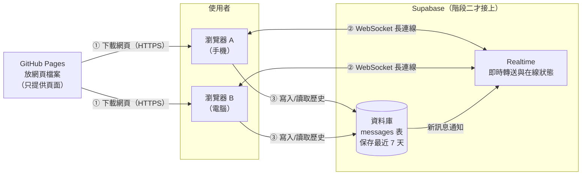
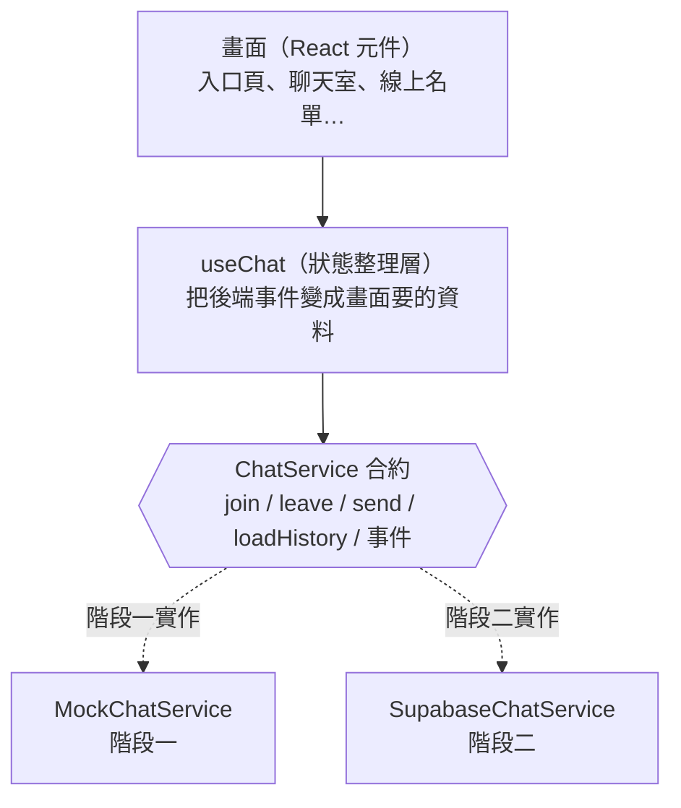
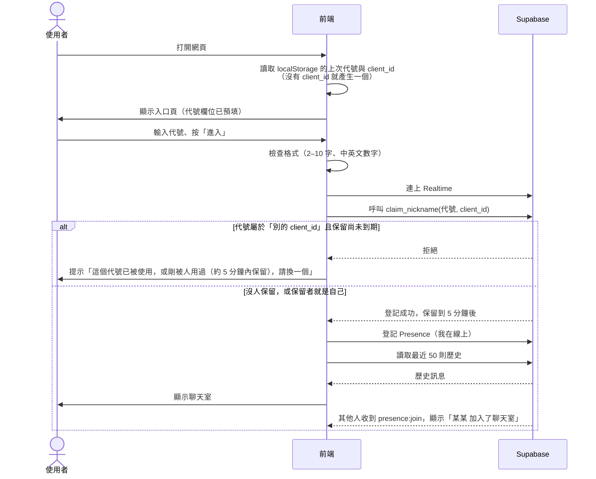
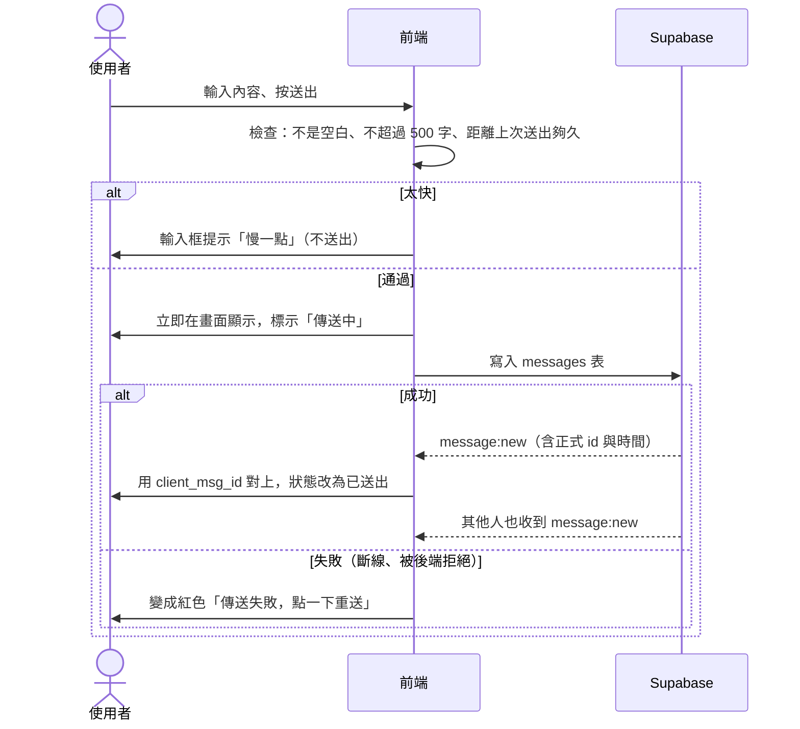
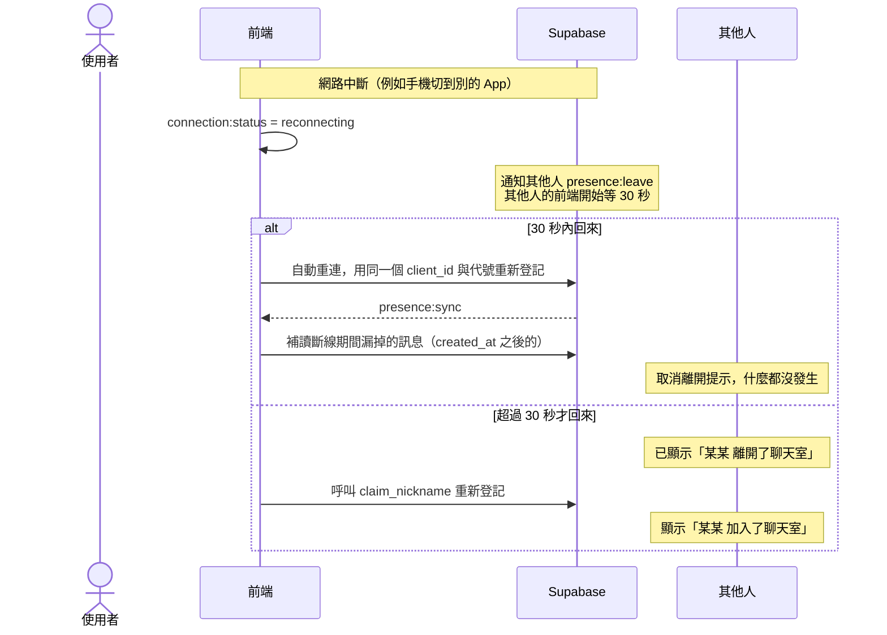

# 匿名聊天室：架構文件

> 這份文件是「蓋房子前的設計圖」。它說明這個聊天室由哪些部分組成、各自負責什麼、為什麼這樣選。
> 文件中的專有名詞，第一次出現時都會用一句話解釋。
> 這份文件不含任何程式，視覺風格（顏色、字體、版面）留給之後的 `/design` 與 `/frontend-design`。

---

## 1. 專案說明與目標

**這是什麼**：一個不用註冊、不用登入的匿名聊天室。任何人拿到網址，輸入一個代號就能進來，和同時在線上的所有人聊天。電腦和手機都能用。

**要達成的事**

- 輸入代號就能進入，不需要帳號。
- 所有人都在同一個聊天室，訊息即時出現。
- 看得到誰在線上，有人進出時有提示。
- 新加入的人能看到最近的對話。
- 手機和電腦都好用。

**已和你確認的行為規則**（整份文件都以此為準）

| 項目 | 決定 |
|---|---|
| 代號 | 2 到 10 個字，只能中英文和數字；有人在線上用了就不能重複；瀏覽器會記住上次的代號 |
| 代號保留 | 人離開後，他的代號**約 5 分鐘**內不會被別人使用；原本那個瀏覽器回來可以直接拿回 |
| 訊息 | 純文字；網址自動變成可點的連結；每則顯示代號、內容、時間；自己的靠右、別人的靠左 |
| 歷史 | 新加入的人看到最近 50 則；只保留 7 天 |
| 進出提示 | 聊天中插入一行小字；只有當下在線的人看得到，不存進歷史 |
| 斷線 | 30 秒內重新連上，不算離開，別人不會看到離開提示 |
| 線上名單 | 電腦版固定在右側；手機版收成頂端的人數，點開才看到名單 |
| 防洗版 | 每人送訊息有時間間隔，太快會提示「慢一點」 |
| 送出失敗 | 訊息先顯示「傳送中」，失敗變紅色，點一下可重送 |
| 不做 | 編輯、刪除、註冊、登入 |
| 外觀 | 「深夜電台」風格；介面有繁體中文與英文，依瀏覽器語言自動切換 |

---

## 2. 整體架構圖

先認識三個角色：

- **瀏覽器**：使用者手上的網頁（電腦或手機）。聊天室的畫面和操作邏輯都在這裡執行。
- **GitHub Pages**：GitHub 提供的免費「網頁放置處」。它只負責把網頁檔案交給瀏覽器，**本身不處理任何聊天內容**。
- **Supabase**：一個線上的後端服務（可以想成「聊天室的大腦和倉庫」）。它負責即時轉送訊息、記錄誰在線上、保存歷史訊息。



**怎麼讀這張圖**

1. 使用者打開網址，瀏覽器從 GitHub Pages 下載網頁（①）。之後 GitHub Pages 就沒事做了。
2. 網頁啟動後，瀏覽器直接和 Supabase 建立一條 **WebSocket**（一條開著不關的雙向通道，讓伺服器能主動把新訊息推給你，不用你一直重新整理）（②）。
3. 送出訊息時，瀏覽器把訊息寫進 Supabase 的資料庫（③）；資料庫一有新訊息，Supabase 就透過 WebSocket 通知所有在線的人。
4. 進入時，瀏覽器從資料庫讀最近 50 則歷史訊息（③）。

**重點**：沒有「我們自己架的伺服器」。網頁在 GitHub Pages，後端全交給 Supabase，所以不用維護任何主機。

---

## 3. 技術選擇

每項都寫「選了什麼」和「為什麼」。

### 3.1 前端（使用者看到的網頁）

| 項目 | 選擇 | 為什麼 |
|---|---|---|
| 語言 | **TypeScript** | 它是 JavaScript（網頁唯一原生的程式語言）加上「資料型別檢查」。例如規定訊息一定要有 `nickname` 欄位，漏寫時工具會立刻報錯。這份文件第 5 節定義的資料格式，可以直接變成程式裡的規則，減少寫錯。 |
| 框架 | **React** | 框架是一套「蓋網頁的現成工具組」。React 很適合這種「畫面會一直跟著資料變動」的應用（新訊息進來、名單變化、狀態改變）。它是最普及的選擇，資料多、AI 工具也最熟悉。 |
| 建置工具 | **Vite** | 把我們寫的程式打包成瀏覽器能讀的檔案，並提供開發時的即時預覽。設定少、速度快，輸出的是純靜態檔案，正好可以放上 GitHub Pages。 |
| 多語言 | **react-i18next**（或同類的小套件） | i18n 指「介面文字抽出來放進語言檔」。中、英文各一份，依 `navigator.language`（瀏覽器回報的語言）選擇，不是中文就用英文。 |

**為什麼不選別的**：純手寫 HTML/JS 在專案小時可行，但「訊息狀態、線上名單、斷線重連」這些會互相牽動的畫面，不用框架會很快變亂。Next.js 等需要伺服器的框架則和 GitHub Pages（只能放靜態檔案）不合。

### 3.2 後端（Supabase 用哪些功能）

Supabase 有很多功能，這個專案只用三個：

| Supabase 功能 | 用來做什麼 | 為什麼 |
|---|---|---|
| **Postgres 資料庫**（一種常見的資料庫，資料像試算表一樣放在表格裡） | 一張 `messages` 表，保存最近 7 天的訊息 | 歷史訊息必須「存起來」，重新整理後還在。 |
| **Realtime：Postgres Changes** | 資料庫新增一則訊息時，自動通知所有連線中的瀏覽器 | 「存」和「即時送給大家」走同一條路，不會出現「大家看到了但沒存到」或反過來的不一致。 |
| **Realtime：Presence**（在線狀態功能，每個連線的人可以登記「我在線上」，Supabase 自動維護名單，斷線自動移除） | 線上名單、進出提示、代號是否被占用 | 這正是 Presence 設計來做的事，不用自己寫「誰在線上」的邏輯。 |

另外兩個輔助功能：

- **Row Level Security（RLS，列級安全）**：資料庫的「門禁規則」，用來規定匿名訪客「只能讀、只能新增、不能改或刪」。這是安全的核心，見第 9 節。
- **pg_cron**（資料庫內建的排程功能）：每天自動刪除超過 7 天的訊息，以及已過期的代號保留紀錄。
- **代號保留表 `nickname_reservations`＋資料庫函式 `claim_nickname`**：表裡記著「哪個代號目前屬於哪個 `client_id`，到什麼時候為止」。**函式**是存放在資料庫裡的一小段規則，進入聊天室時由它一次完成「檢查＋登記」，同一個代號同一時間只會放行一個人。這樣「代號被占用」的判斷，統一以這張表為準（Presence 只負責顯示線上名單）。匿名訪客**不能直接寫這張表**，只能呼叫這個函式。這不算 Edge Functions，仍然沒有我們自己架的伺服器。

**刻意不用**：Supabase Auth（登入，因為不需要）、Storage（檔案儲存，因為不傳圖片）、Edge Functions（自訂伺服器程式，目前沒有需要）。

**為什麼訊息不只用「廣播」（Broadcast，只轉送、不存檔）**：因為要有歷史。若只廣播，晚到的人就看不到任何東西，還得另外補一套儲存機制。

---

## 4. 兩個階段

你指定的順序：**先把前端做好放上 GitHub Pages 看得到，最後才接 Supabase。**

### 4.1 階段一：假後端（尚未接 Supabase）

**目標**：畫面與操作完整可用，任何人打開 GitHub Pages 的網址都能「玩」到聊天室。

**怎麼做到**：寫一個「假後端」（本文稱 **MockChatService**）。它在瀏覽器裡模擬 Supabase 的行為：

| 功能 | 階段一的做法 |
|---|---|
| 訊息保存 | 存在瀏覽器的 `localStorage`（瀏覽器內建的小型儲存空間，只存在這台裝置） |
| 多人互動 | 用 `BroadcastChannel`（瀏覽器內建功能，讓**同一瀏覽器**的多個分頁互相傳話）。同時開兩個分頁，就像兩個人在聊天 |
| 熱鬧感 | 加入幾個「示範機器人」，會定時說話、進出，讓你看到進出提示、名單變化、不同人的訊息配色 |
| 失敗情境 | 提供一個「模擬網路中斷」的隱藏開關（例如網址加 `?demo=offline`），好測試「傳送失敗、點擊重送」 |
| 防洗版、代號重複、代號保留 | 用和真實版相同的規則實作；保留紀錄也存在 `localStorage`，附到期時間，同一瀏覽器的各分頁共用 |

**階段一做得到的**：所有畫面、所有互動、所有提示和錯誤狀態、手機與電腦版面、中英文切換。
**階段一做不到的**：真正的「不同人、不同裝置」之間的聊天；內容不會跨裝置同步。

**怎麼在 GitHub Pages 看到**：每次把程式推上 GitHub，自動化流程（GitHub Actions）會重新打包並發布，網址通常是 `https://<你的帳號>.github.io/<repo 名稱>/`。詳見第 12 節。

> 頁面上階段一要放一行小字「示範模式：訊息只存在你的瀏覽器」，避免訪客誤以為已經能跟別人聊天。階段二接上後移除。

### 4.2 階段二：接上 Supabase

要改變的只有「後端的那一層」：

- 把 `MockChatService` 換成 `SupabaseChatService`。
- 在 GitHub 設定 Supabase 的網址與公開金鑰（第 8 節）。
- 在 Supabase 建立資料表（含代號保留表與 `claim_nickname` 函式）、門禁規則、定時清理。
- 移除示範機器人與示範提示。
- 兩個分頁變成真正的多人，且跨裝置。

### 4.3 如何避免階段二「整個重寫」

關鍵做法：**畫面不直接碰後端，只透過一份固定的「合約」溝通。**



規則：

1. 畫面程式裡**不允許**出現 Supabase 字樣，只能呼叫 `ChatService`。
2. `ChatService` 的函式和事件，就是第 5 節的「通訊約定」。兩種實作都必須遵守同一份約定。
3. 用一個設定值（環境變數）決定載入哪一種實作：沒有 Supabase 設定就用 Mock，有就用 Supabase。
4. 防洗版、代號格式、網址轉連結等**規則放在共用層**，兩種實作都用同一份，不會「階段二行為變了」。

這樣階段二的工作量，就只有「寫一個新檔案 + 設定 Supabase」，畫面一行都不用動。

---

## 5. 通訊約定

這節定義「前端與後端之間講什麼話」。兩個階段都照這份。

### 5.1 資料格式

**ChatMessage（一則聊天訊息）**

| 欄位 | 型別 | 說明 |
|---|---|---|
| `id` | 文字（UUID，一種不會重複的亂數編號） | 由資料庫產生，每則唯一 |
| `client_msg_id` | 文字（UUID） | 由瀏覽器送出前產生，用來把「我剛送出的那則」和資料庫傳回的正式版本對上，避免重複顯示 |
| `client_id` | 文字（UUID） | 這個瀏覽器的匿名身分編號，第一次進來時產生，存在 `localStorage`。用來判斷「這則是不是我的」與「這個代號是不是我之前用的」 |
| `nickname` | 文字 | 發話者代號（2–10 字） |
| `content` | 文字 | 訊息內容（1–500 字） |
| `created_at` | 時間 | 由資料庫寫入的時間（以伺服器為準，不信任使用者裝置的時鐘） |

**PresenceInfo（一位在線者的資訊，登記在 Presence）**

| 欄位 | 型別 | 說明 |
|---|---|---|
| `client_id` | 文字 | 同上 |
| `nickname` | 文字 | 目前使用的代號 |
| `joined_at` | 時間 | 加入時間（顯示與排序用） |

**Reservation（代號保留紀錄，存在資料庫的 `nickname_reservations` 表）**

| 欄位 | 型別 | 說明 |
|---|---|---|
| `nickname_key` | 文字 | 代號轉成小寫後的版本，用來比對（`Amy` 和 `amy` 視為同一個）。每個值在表中只能出現一次 |
| `nickname` | 文字 | 代號原本的樣子（保留使用者輸入的大小寫） |
| `client_id` | 文字 | 這個代號目前屬於哪個瀏覽器 |
| `expires_at` | 時間 | 保留到什麼時候。在線時，前端每 60 秒呼叫一次函式把它延到「現在＋5 分鐘」；離開（或斷線）後不再延長，時間一到就失效 |

另有一條規則：**同一個 `client_id` 同時只能保留一個代號**。換代號時，舊的立刻釋放。

**SystemNotice（進出提示，只存在畫面上，不存資料庫）**

| 欄位 | 型別 | 說明 |
|---|---|---|
| `kind` | `"join"` 或 `"leave"` | 進入或離開 |
| `nickname` | 文字 | 是誰 |
| `at` | 時間 | 發生時間（用來排在對話中的正確位置） |

**本機的訊息狀態**（只在自己的畫面上）：`sending`（傳送中）→ `sent`（成功）或 `failed`（失敗，可重送）。

### 5.2 前端可呼叫的動作（ChatService 提供）

| 動作 | 輸入 | 結果 |
|---|---|---|
| `join(nickname)` | 代號 | 成功：進入聊天室；失敗：回報原因 `NICKNAME_TAKEN`（有人正在線上用）、`NICKNAME_RESERVED`（剛離開的人還在保留期內）或 `CONNECTION_FAILED`（連不上）。前端用 Presence 名單區分前兩者：名單裡有就是 `TAKEN`，沒有就是 `RESERVED` |
| `leave()` | 無 | 主動離開 |
| `sendMessage(content)` | 內容 | 成功回傳 `ChatMessage`；失敗回報 `RATE_LIMITED`（太快）、`INVALID`（內容不合格）、`SEND_FAILED`（網路或後端問題） |
| `loadHistory()` | 無 | 回傳最近 50 則訊息（近 7 天內，由舊到新） |

### 5.3 後端會通知前端的事件

| 事件名稱 | 何時發生 | 附帶資料 |
|---|---|---|
| `message:new` | 有人送出新訊息（包含自己的） | `ChatMessage` |
| `presence:sync` | 剛進入，或名單整體更新 | `PresenceInfo[]`（完整名單） |
| `presence:join` | 有人加入 | `PresenceInfo` |
| `presence:leave` | 有人離開（已過 30 秒緩衝） | `PresenceInfo` |
| `connection:status` | 連線狀態改變 | `"connected"`、`"reconnecting"`、`"disconnected"` |

> **關於 30 秒緩衝**：Supabase 在一個人斷線時會馬上通知「他離開了」。為了不要在手機切換 App 時洗版，前端收到後**先等 30 秒**；若同一個 `client_id` 在這期間回來了，就取消這次提示。這個邏輯放在共用層，兩階段共用。

---

## 6. 資料流

### 6.1 進入聊天室



**兩個人同時搶同一個代號**：資料庫一次只處理一個請求，先到的拿到，後到的被拒絕。不需要前端另外補救。

**在線期間**：前端每 60 秒呼叫一次函式，把保留時間延到「現在＋5 分鐘」，所以在線的人不會被別人搶走代號。

### 6.2 送出訊息



### 6.3 離開

- **主動離開**（關閉分頁或按離開）：瀏覽器盡力通知 Supabase；其他人看到「某某 離開了聊天室」。
- **沒有任何通知就消失**（直接關機、沒電）：Supabase 偵測到連線逾時後自動把他從名單移除，並通知其他人。

兩種情況，其他人都會先經過第 5.3 節的 30 秒緩衝才看到提示。

**代號保留**：離開後前端不再延長保留時間，所以代號會在最後一次延長後的 5 分鐘內到期（實際是離開後約 4 到 5 分鐘）。主動離開和直接消失的處理方式相同，不需要額外通知資料庫。

### 6.4 斷線重連



**代號在斷線期間**：保留時間在斷線時不再延長，最多撐 5 分鐘。5 分鐘內回來，用同一個 `client_id` 就能直接拿回。離線超過 5 分鐘，代號可能已被別人使用，此時重連會失敗並回到入口頁，顯示「你的代號已被使用，請重新選一個」。

重連時**補讀漏掉的訊息**很重要：斷線期間別人說的話，重連後要補上，不然對話會有缺口。

斷線期間若使用者按送出，訊息會顯示「傳送中」，逾時後變成「傳送失敗」，使用者可點擊重送（對應你在 Q10 選的行為）。

---

## 7. 畫面清單

只規定「有什麼元素、做什麼事」，不規定外觀。

### 7.1 入口頁

| 元素 | 行為 |
|---|---|
| 標題與一句說明 | 說明這是匿名聊天室 |
| 代號輸入框 | 預填上次使用的代號；即時顯示格式錯誤（太短、太長、有不允許的字元） |
| 「進入聊天室」按鈕 | 格式錯誤時不可按；按下後顯示「連線中」並停用，避免重複按 |
| 錯誤訊息區 | 顯示「代號已被使用」、「這個代號剛被使用過，約 5 分鐘內保留，請換一個或稍後再試」、「無法連線，請稍後再試」 |
| 示範模式提示（僅階段一） | 說明訊息只存在本機 |

### 7.2 聊天室頁

**頂端列**

| 元素 | 行為 |
|---|---|
| 聊天室名稱 | 固定文字 |
| 線上人數 | 例如「5 人在線」；手機版點擊會展開線上名單；電腦版僅顯示 |
| 離開按鈕 | 回到入口頁（並主動離開） |

**訊息區**

| 元素 | 行為 |
|---|---|
| 他人的訊息 | 靠左；顯示代號、內容、時間 |
| 自己的訊息 | 靠右；顯示內容、時間（代號可省略） |
| 訊息狀態 | 「傳送中」；「失敗」時整則變紅，點一下重送 |
| 進出提示 | 置中的一行小字，例如「小明 加入了聊天室」，混在訊息之間按時間排列 |
| 內容中的網址 | 自動變成可點連結，新分頁開啟 |
| 自動捲動 | 在最底部時，新訊息進來自動捲到底；若使用者往上捲在看舊訊息，則不強制捲動，並出現「有新訊息 ↓」按鈕 |
| 空狀態 | 沒有任何歷史時，顯示一句歡迎詞 |

**輸入區**

| 元素 | 行為 |
|---|---|
| 輸入框 | 最多 500 字，接近上限時顯示剩餘字數；手機與電腦的 Enter 行為見下 |
| 送出按鈕 | 內容為空白時不可按 |
| 「慢一點」提示 | 送太快時在輸入框附近短暫出現 |

> **Enter 的行為**：電腦上 Enter 送出、Shift+Enter 換行；手機上 Enter 為換行，靠按鈕送出（避免誤送）。

**線上名單（電腦版固定在右側；手機版為點開後的浮層）**

| 元素 | 行為 |
|---|---|
| 名單 | 列出所有在線代號；自己的代號有「你」標記 |
| 關閉（僅手機） | 收起浮層 |

### 7.3 補充畫面狀態

這些是你沒明確提過、但實作時一定會遇到的情況，我先列出，請確認：

- **連線中**：進入時，連上 Supabase 之前顯示載入狀態。
- **無法連線**：入口頁的錯誤提示（見 7.1）。
- **斷線中的整體提示**：你在 Q10 沒有選「頂端顯示連線中斷」。所以斷線時**不會有全域橫幅**，使用者只能從「送不出去」感覺到。若之後覺得不夠清楚，這個橫幅可以很容易補上，因為事件 `connection:status` 已經預留。

---

## 8. 金鑰

「金鑰」是用來向 Supabase 證明「我有權限」的長字串。這個專案會碰到的有：

| 名稱 | 是什麼 | 能公開嗎 | 放在哪裡 |
|---|---|---|---|
| **Project URL** | 你的 Supabase 專案網址，例如 `https://xxxx.supabase.co` | ✅ 可以 | 前端設定（會被打包進網頁） |
| **公開金鑰**（Supabase 介面上可能叫 `anon key` 或 `publishable key`） | 給網頁用的金鑰，權限很低，**設計上就是要放進網頁、任何人看得到** | ✅ 可以 | 前端設定（同上） |
| **祕密金鑰**（`service_role key` 或 `secret key`） | 超級管理員金鑰，能繞過所有門禁規則，**拿到就能讀寫、刪光所有資料** | ❌ **絕對不能** | **這個專案完全用不到，不要複製它、不要貼到任何地方** |
| **資料庫密碼** | 建立專案時設定的密碼，用於直接連資料庫 | ❌ **絕對不能** | 只存在密碼管理員；專案程式不需要 |
| **Supabase 帳號密碼** | 登入 Supabase 後台 | ❌ **絕對不能** | 開啟兩步驟驗證 |

**為什麼公開金鑰放在網頁裡是安全的**：因為真正的保護來自資料庫的 **RLS 門禁規則**（第 9 節）。公開金鑰只是「入場券」，入場後能做什麼，由規則決定。所以安全的重點不是藏金鑰，而是把規則設好。

### 怎麼產生

1. 到 supabase.com 註冊並建立新專案（選離使用者近的區域，例如東京或新加坡；設定資料庫密碼並存好）。
2. 進入專案後台的 **Project Settings → API**（介面名稱可能微調），會看到 Project URL 與公開金鑰。複製這兩個。
3. 同一頁面也會顯示祕密金鑰，**不要複製**。

### 放在哪裡、怎麼避免被推上 GitHub

- **本機開發**：放在專案根目錄的 `.env.local` 檔案。這個檔案名稱要加進 `.gitignore`（Git 的「不要追蹤清單」），Git 就不會把它推上去。
- **提供範本**：repo 裡放 `.env.example`，只有欄位名稱、沒有真值，告訴別人需要填什麼。
- **正式部署**：在 GitHub 的 repo 設定 **Settings → Secrets and variables → Actions** 填入。自動化流程打包時才讀取。（Project URL 與公開金鑰用「Variables」或「Secrets」都可以；用 Secrets 比較不易被人隨手看到，但最終仍會出現在打包後的網頁裡，這是正常的。）
- **多一層保護**：開啟 GitHub 的 **Secret scanning 與 Push protection**（偵測到金鑰時擋下推送，在 repo 的 Settings → Code security 設定）。
- **如果不小心推上去了**：立刻到 Supabase 後台重新產生（rotate）該金鑰。單純刪除檔案沒有用，因為 Git 歷史還留著。
- **GitHub 本身的權限**：自動部署用的是 GitHub 內建的權限，不需要建立任何個人 token。

---

## 9. 安全與限制

### 9.1 別人可能送進來的奇怪東西，以及怎麼擋

核心原則：**前端的檢查只是為了好用，不是為了安全。** 懂技術的人可以繞過網頁，直接對 Supabase 發請求。所以**真正的底線要設在資料庫**。

| 風險 | 前端怎麼擋 | 資料庫怎麼擋 |
|---|---|---|
| **惡意程式碼**（在訊息裡塞 `<script>`，想在別人瀏覽器執行，稱為 XSS） | 所有內容一律當「純文字」顯示，絕不當成 HTML。React 預設就是這樣；**禁止**使用 `dangerouslySetInnerHTML` | —（資料庫照存，顯示端負責） |
| **危險網址**（`javascript:...` 之類） | 自動轉連結只認 `http://` 與 `https://`；連結加上 `rel="noopener noreferrer nofollow"` 並新分頁開啟 | — |
| **超長訊息** | 輸入框限制 500 字 | `messages.content` 加長度限制，超過直接拒絕 |
| **空白訊息／全是空白或隱形字元** | 去掉頭尾空白，清除零寬字元，空的不給送 | 加檢查規則，拒絕空內容 |
| **方向控制字元**（會讓文字顯示順序顛倒，用來偽裝） | 過濾 | 同左，加入檢查 |
| **代號偽裝**（全形英文、長得像的字、含空白） | 代號只允許中英文數字；英文比對時不分大小寫 | 代號長度與格式也加檢查；比對用小寫版本 |
| **搶占剛離開的人的代號** | 入口頁顯示明確提示 | `claim_nickname` 函式檢查保留紀錄，保留期內只放行原本的 `client_id` |
| **用腳本一口氣占住大量代號** | — | 同一個 `client_id` 同時只能保留一個代號；保留表不開放匿名直接寫入 |
| **在訊息中冒充別人** | 無法完全防止（見 9.3） | — |
| **洗版** | 送出間隔限制（預設 1 秒） | 資料庫規則：同一個 `client_id` 在 1 秒內再次寫入就拒絕 |
| **亂改／亂刪別人的訊息** | 介面上沒有這個功能 | RLS 規則：匿名訪客對 `messages` 只有「讀取」與「新增」權限，**沒有更新與刪除**；對保留表**完全沒有直接存取權**，只能呼叫函式 |
| **大量灌入垃圾資料** | — | 見 9.3 |

### 9.2 免費方案的上限

> 以下數字是撰寫時的一般認知，Supabase 可能調整。**開始階段二之前，請到 Supabase 官方定價頁確認最新數字。**

| 項目 | 需要注意的地方 |
|---|---|
| **同時連線數**（同一時間開著聊天室的人數） | 免費方案有上限（大約是兩百人等級）。對一般分享連結的使用量足夠；超過時新來的人會連不上 |
| **每月 Realtime 訊息量** | 有月上限。每則聊天訊息會廣播給所有在線的人，所以「在線人數 × 訊息數」才是實際消耗 |
| **資料庫大小** | 有上限（約 500 MB 等級）。純文字、保留 7 天，遠遠用不完 |
| **專案自動暫停** | 免費專案若約一週沒有任何活動，會被暫停，需要到後台手動恢復。**這可能造成「連結打開卻連不上」**，要有心理準備，並把「連不上」的錯誤提示做好 |
| **GitHub Pages** | 公開 repo 免費。網站有流量與容量的軟性限制，一個純文字聊天室遠遠不會碰到 |

### 9.3 這一版承認的限制

- **匿名代表無法驗證身分**：因為沒有登入，我們只能保護「同一個瀏覽器」。代號在對方在線時，以及離開後約 5 分鐘內受到保護；之後任何人都能使用。另外，有人仍可在訊息裡自稱是別人，系統無法阻止。
- **保留綁定的是瀏覽器，不是人**：使用者若清除瀏覽器資料、換手機或換瀏覽器，就失去自己的 `client_id`，這段期間拿不回自己的代號，必須等保留期過。這是不登入的必然結果。
- **資料庫層的限流只能擋「很快」的洗版**：沒有登入，就沒有可靠方式限制「一個人」。有人換瀏覽器、清除資料就能換一個 `client_id`。若真的被人惡意灌爆，補救方式是到 Supabase 後台手動刪資料或暫時關閉寫入，之後再考慮加機器人驗證（例如 Cloudflare Turnstile）。
- **訊息是公開的**：任何拿到公開金鑰的人都能讀所有訊息。這是公開聊天室本來的性質。請不要在聊天室中分享私密資訊，並在畫面上提醒。

---

## 10. 這一版刻意不做的事

| 不做 | 為什麼 |
|---|---|
| 註冊、登入 | 你明確不要；這也是「匿名」的本質 |
| 編輯、刪除訊息 | 匿名下系統無法可靠確認「這則是你的」；也讓對話保持誠實（更正就再發一句） |
| 圖片、檔案、貼圖 | 增加儲存成本與審核風險；先把文字版做穩 |
| 多個聊天室／私訊 | 需求是「所有人在同一個聊天室」 |
| 永久註冊代號（讓某人永遠擁有一個代號） | 需要登入才能確認是同一個人；本版只做約 5 分鐘的短期保留 |
| 管理員、封鎖、檢舉 | 沒有帳號就沒有可靠的封鎖對象；先觀察實際狀況再決定 |
| 推播通知 | 需要登入或額外服務；網頁版的聊天室不需要 |
| 輸入中提示、已讀 | 增加大量即時流量，對免費額度不友善，且非核心需求 |
| 斷線全域橫幅 | 你在 Q10 沒選；保留事件，之後容易補上 |
| 手動切換語言按鈕 | 你選的是依瀏覽器自動切換 |
| 手動切換淺色／深色 | 只做「深夜電台」單一風格 |
| 自己架伺服器 | 全交給 Supabase，省去維護成本 |
| 用 Next.js 等需要伺服器的框架 | GitHub Pages 只能放靜態檔案 |

---

## 11. Repo 資料夾結構

```
new/
├── docs/
│   ├── requirements.md          需求說明（你寫的）
│   └── architecture.md          本文件
├── src/
│   ├── main.tsx                 程式進入點
│   ├── App.tsx                  決定顯示入口頁還是聊天室
│   ├── components/              畫面元件
│   │   ├── EntryScreen.tsx        入口頁
│   │   ├── ChatRoom.tsx           聊天室頁
│   │   ├── MessageList.tsx        訊息區（含進出提示）
│   │   ├── MessageItem.tsx        單則訊息
│   │   ├── MessageInput.tsx       輸入區
│   │   └── OnlineList.tsx         線上名單
│   ├── chat/                    聊天邏輯（與畫面無關）
│   │   ├── types.ts               第 5 節的資料格式
│   │   ├── ChatService.ts         合約（介面定義）
│   │   ├── MockChatService.ts     階段一：假後端
│   │   ├── mock/                  假後端用的零件（階段二可整個移除）
│   │   │   ├── storage.ts           用 localStorage 當資料表（訊息、代號保留）
│   │   │   └── bots.ts              示範機器人
│   │   ├── SupabaseChatService.ts 階段二才新增：真後端
│   │   ├── identity.ts            這個瀏覽器的 client_id、記住上次的代號
│   │   ├── createChatService.ts   依設定決定用哪一個
│   │   ├── rules.ts               代號格式、訊息檢查、限流、30 秒緩衝
│   │   ├── linkify.ts             網址轉連結（只認 http/https）
│   │   └── useChat.ts             把事件整理成畫面要的資料
│   ├── i18n/
│   │   ├── zh-Hant.json           繁體中文文字
│   │   ├── en.json                英文文字
│   │   └── index.ts               語言選擇邏輯
│   └── styles/                  樣式（由 /design 決定）
├── supabase/                    階段二才會用到
│   ├── schema.sql                 資料表（含代號保留表）、claim_nickname 函式、RLS 規則、定時清理
│   └── README.md                  在 Supabase 後台要點哪些設定
├── .github/workflows/
│   └── deploy.yml               自動打包並發布到 GitHub Pages
├── index.html
├── vite.config.ts               含 GitHub Pages 的路徑設定
├── tsconfig.json
├── package.json
├── .env.example                 金鑰欄位範本（沒有真值，可以 commit）；階段二的欄位名稱為 VITE_SUPABASE_URL、VITE_SUPABASE_PUBLISHABLE_KEY
├── .env.local                   真正的金鑰（已在 .gitignore，不會上傳）
└── .gitignore
```

---

## 12. 部署到 GitHub Pages

**部署原理**：每次你把程式推到 `main` 分支，GitHub Actions（GitHub 內建的自動化機器人）會自動：安裝需要的套件 → 打包 → 把成品發布到 GitHub Pages。你不用手動上傳任何檔案。

**一次性設定**

1. 把專案推到 GitHub（repo 需為公開，免費方案的 Pages 才能使用）。
2. 到 repo 的 **Settings → Pages**，把 **Source** 設為 **GitHub Actions**。
3. 在 `vite.config.ts` 設定 `base` 為 `/<repo 名稱>/`。因為 Pages 網址是 `帳號.github.io/repo名稱/`，網頁要知道自己不在網站根目錄，否則會出現白畫面、找不到檔案。
4. （階段二）到 **Settings → Secrets and variables → Actions** 填入 Supabase 的 Project URL 與公開金鑰。

**之後每次更新**：推送到 `main` → 約一兩分鐘後網站自動更新。可到 repo 的 **Actions** 分頁查看進度與錯誤。

**網址**：`https://<你的帳號>.github.io/<repo 名稱>/`

**補充**：因為是單一頁面應用（入口頁與聊天室都在同一個網址內切換），不需要處理 GitHub Pages 常見的「重新整理就 404」問題。

---

## 13. 驗證清單

### 階段一：假後端

**部署**
- [ ] 推送後，GitHub Actions 成功完成
- [ ] 用公開網址能打開，不是白畫面
- [ ] 重新整理頁面不出現 404

**入口**
- [ ] 代號少於 2 字、多於 10 字、含符號或空白，都會被擋並顯示原因
- [ ] 合格代號能進入
- [ ] 第二次打開時，上次的代號已預填
- [ ] 同時開兩個分頁，第二個用同名代號會被提示「已被使用」
- [ ] 關掉第一個分頁後，這個代號在約 5 分鐘內，別的 `client_id`（例如無痕視窗）用不了，提示為「剛被使用過」
- [ ] 原本的瀏覽器在保留期內回來，可以直接用同一個代號進入
- [ ] 超過保留期後，任何人都可以使用這個代號

**聊天**
- [ ] 送出訊息後，自己的靠右、別人（另一個分頁或示範機器人）的靠左，且配色不同
- [ ] 每則顯示代號與時間
- [ ] 空白訊息不能送；超過 500 字不能送
- [ ] 連續快速送出會出現「慢一點」
- [ ] 含 `https://` 的訊息變成可點連結；含 `javascript:` 的文字**不會**變成連結
- [ ] 輸入 `<script>alert(1)</script>` 只會當文字顯示，不會執行
- [ ] 重新整理後，仍看到最近 50 則歷史；進出提示**不在**歷史中
- [ ] 往上捲動時，新訊息不會強制拉到最底，並出現「有新訊息」按鈕

**在線與提示**
- [ ] 線上人數與名單正確
- [ ] 有人進來、離開時，出現一行小字提示
- [ ] 關掉分頁後立刻重新開啟（30 秒內），別人不會看到離開提示
- [ ] 失敗模擬開啟時，訊息變紅色，點擊可重送

**版面與語言**
- [ ] 手機寬度（約 375px）下沒有橫向捲動，名單收成頂端人數，點開可看
- [ ] 電腦寬度下名單固定在右側
- [ ] 瀏覽器語言為繁體中文時顯示中文，其他語言顯示英文
- [ ] 找幾位朋友實際用手機開網址，操作順暢

### 階段二：接上 Supabase

**設定與金鑰**
- [ ] 專案內搜尋不到祕密金鑰與資料庫密碼（含 Git 歷史）
- [ ] `.env.local` 不在 `git status` 的待提交清單中
- [ ] GitHub 上 Secret scanning 與 Push protection 已開啟
- [ ] 打包後的網頁只含 Project URL 與公開金鑰

**真實多人**
- [ ] 兩台不同裝置（手機＋電腦）可互相聊天，即時出現
- [ ] 關閉網頁再打開，歷史訊息還在
- [ ] 線上名單與進出提示在兩台裝置間正確
- [ ] 不同裝置用同一個代號，後者被擋下
- [ ] 一台裝置關掉網頁，另一台裝置在 5 分鐘內用同名代號，被擋下並顯示保留提示；原裝置回來可直接拿回
- [ ] 超過保留期（可先暫時調短來驗證）後，別人可以使用該代號
- [ ] 兩台裝置幾乎同時用同一個代號，只有一台成功
- [ ] 在線超過 5 分鐘，代號仍屬於自己（確認每 60 秒延長有在運作）
- [ ] 離線超過 5 分鐘、且代號被別人拿走後重連，會回到入口頁並顯示清楚提示
- [ ] 用公開金鑰直接對保留表讀寫，會被拒絕
- [ ] 同一個人手機鎖屏 10 秒後回來，其他人沒看到離開提示
- [ ] 斷線超過 30 秒後回來，其他人看到離開與加入
- [ ] 斷線期間別人的訊息，重連後有補上
- [ ] 關閉 Wi-Fi 後送訊息，變成失敗，開網路後點擊重送成功

**安全**
- [ ] 用公開金鑰直接對資料庫送出「修改」或「刪除」，會被拒絕
- [ ] 繞過前端、直接寫入超過 500 字的內容，被資料庫拒絕
- [ ] 繞過前端、1 秒內連續寫入，第二次被拒絕
- [ ] 7 天前的測試訊息已被自動清除（可先把保留期暫時調短來驗證）

**限制**
- [ ] 已確認 Supabase 免費額度的最新數字，並記錄下來
- [ ] 專案被暫停時，使用者看到的是清楚的錯誤提示，而不是白畫面
- [ ] 移除階段一的「示範模式」提示與機器人

---

## 附：待你確認的事項

1. 第 7.3 節：斷線時沒有全域橫幅，這樣可以嗎？（你在 Q10 只選了「訊息狀態」）
2. 第 7.2 節：手機上 Enter 是換行、不是送出，這樣可以嗎？
3. 第 9.3 節：接受「匿名代表無法防止冒充」這個限制嗎？
4. 第 12 節：GitHub repo 需要是公開的（免費 Pages 的限制），可以嗎？
5. 代號保留的 5 分鐘：實際效果是離開後約 4 到 5 分鐘，這樣可以嗎？
